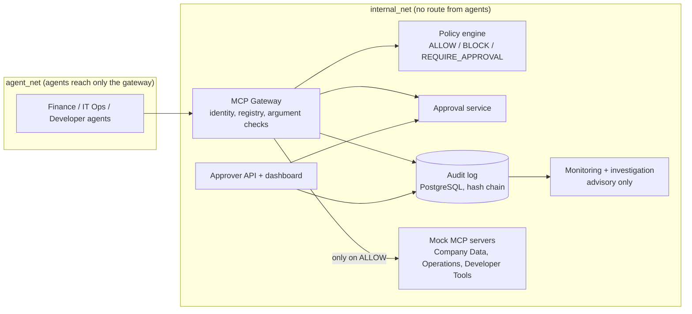

# Agent Firewall

A policy-enforcing MCP gateway that sits between AI agents and the tools they use. Every tool call passes through the gateway, which checks who is asking, applies written rules, pauses risky actions for a human, and records everything in a tamper-evident log.

Everything here is a demonstration: the data is synthetic and every tool is a mock.

## What it does

- **Identity:** each agent has its own API key. The gateway decides who is calling from the key, never from what the request says about itself.
- **Policy:** fixed rules (no model involved) return ALLOW, BLOCK or REQUIRE_APPROVAL for every call.
- **Approval:** a paused call waits for a human. An approval runs exactly the request that was approved, once.
- **Audit:** every decision is written to a hash-chained log that shows if a record was changed or removed.
- **Monitoring:** rules and an anomaly model raise alerts on odd behaviour. They never change a decision.
- **Investigation and dashboard:** an advisory workflow explains incidents; a dashboard shows the log, approvals and alerts.


## Architecture



Request flows (ALLOW, BLOCK, REQUIRE_APPROVAL) are in [docs/architecture.md](docs/architecture.md).


Evaluation results (with sample sizes and caveats): [docs/evaluation-report.md](docs/evaluation-report.md).

## Limitations

Read these before relying on anything here.

- **Bypassing the gateway is outside the enforcement boundary.** The gateway can only judge calls that reach it. The Docker network layout stops the demo agents from reaching the tool servers directly, and a test checks that. An agent or tool deployed anywhere else gets no protection.
- **Prompt injection is not prevented.** Hostile text can still steer an agent. The gateway stops the forbidden call that results, not the manipulation behind it. A model that happens to resist an attack is luck, not a defence.
- **The numbers are from a demonstration.** Blocking rates are measured on the attacks this project wrote, and anomaly figures come from simulated traffic. They show the pipeline works. They are not a claim about real-world accuracy.
- **Slow, low-volume abuse is missed.** The "slow scrape" attack is not caught by the rules or the model.
- **Not hardened for production.** Not covered: a compromised gateway host or database administrator, denial of service beyond a simple per-agent rate limit, single sign-on, multiple regions, Kubernetes, and any real banking, HR or cloud system.
- **Humans decide approvals.** The gateway guarantees an approved action runs as approved. It cannot make the human's decision a good one.

The full list is in [docs/threat-model.md](docs/threat-model.md) section 7.

## Run the whole stack with Docker Compose

Needs Docker with Compose v2. Run these from the project folder.

1. Create the settings file and set two passwords (any values you like, they only protect your local stack):

   ```powershell
   copy .env.example .env      # Linux/macOS: cp .env.example .env
   ```

   Edit `.env` and replace both `change-me` values: `POSTGRES_PASSWORD` and `APPROVER_PASSWORD`.

2. Build and start everything (the first build takes a few minutes):

   ```powershell
   docker compose --env-file .env -f infra/docker-compose.yml up -d --build --wait
   ```

   This starts PostgreSQL, the three mock tool servers, the gateway, the approver API and a demo `agent` container. `--wait` returns when every service is healthy.

3. Create the three agents and their keys. A key is shown **once**:

   ```powershell
   docker compose --env-file .env -f infra/docker-compose.yml exec gateway python -m scripts.register_agents
   ```

   Copy the `FINANCE_AGENT_KEY=...` line it prints. (The other two keys go in `.env` the same way if you want to run the agents yourself.)

4. Check that it works. From the `agent` container, which can reach only the gateway, one normal call should run and one over-limit call should be blocked:

   ```powershell
   docker compose --env-file .env -f infra/docker-compose.yml exec -e FINANCE_AGENT_KEY=<paste the key> agent python -m scripts.smoke_test
   ```

   Expected last line: `smoke test: passed`.

5. Stop and remove it (the `-v` also deletes the database):

   ```powershell
   docker compose --env-file .env -f infra/docker-compose.yml down -v
   ```

### Dashboard and approvals

The approver API (and the dashboard it serves) is on the internal network only, so an agent cannot reach it. To use it from your browser, add the local-only override in step 2:

```powershell
docker compose --env-file .env -f infra/docker-compose.yml -f infra/docker-compose.approver-host.yml up -d --build --wait
```

Then open http://127.0.0.1:8000 and sign in as `approver` with your `APPROVER_PASSWORD`. The override publishes the port on your machine and, as its comments explain, also makes it reachable from other containers by IP. Use it for local demos only.

To explore the dashboard on throw-away data without the stack: `uv run python -m scripts.demo_dashboard` (see [docs/demo-script.md](docs/demo-script.md)).

### The unprotected comparison

`--profile baseline` adds an agent that sits next to the tool servers with no gateway in between. It exists only to show what the gateway prevents.

## Development

Needs Python 3.11, [uv](https://docs.astral.sh/uv/) and Node 20 (dashboard only).

```powershell
uv sync
uv run pytest                                  # the full suite (the Docker test needs Docker)
uv run ruff check .
uv run python -m scripts.run_evaluation        # baseline vs gateway, plus the metrics
uv run python -m scripts.security_scan         # secrets, Python and dashboard dependencies
```

Settings are read from `.env`; see `.env.example` for every name. The Gemini key is needed only for the investigation workflow and the model-driven agent runs.

## Design documents

- [Permission matrix](docs/permission-matrix.md)
- [Threat model](docs/threat-model.md)
- [Architecture and request flows](docs/architecture.md)
- [Acceptance criteria](docs/acceptance-criteria.md)
- [Evaluation report](docs/evaluation-report.md)
- [Test matrix](docs/test-matrix.md)

## Synthetic data

All data in this project is synthetic and all operations are mocks. The data lives in `data/seed/` as three JSON files, one per mock MCP server (`company_data.json`, `operations.json`, `developer_tools.json`).

```powershell
uv run python -m scripts.generate_seed                   # write data/seed/ (refuses to overwrite)
uv run python -m scripts.generate_seed --reset           # overwrite with the default data (seed 42)
uv run python -m scripts.generate_seed --seed 7 --reset  # different, equally valid data
```

The same seed always produces identical files. A few records are planted at fixed ids whatever the seed, because the attack scenarios depend on them (for example `BEN-001`, the 12,000 USD invoice `INV-0001`, and the `RES-001` production database).

**Bring your own data:** replace the JSON files in `data/seed/`. They are checked against the schema in `core/seed_models.py` when a server starts: emails must end in `@example.com`, secrets must start with `FAKE-NOT-A-SECRET-`, ids must be unique, and references must point at records that exist. Keep equivalent records for the planted scenarios, or those scenarios will not trigger. There is deliberately no upload feature.
