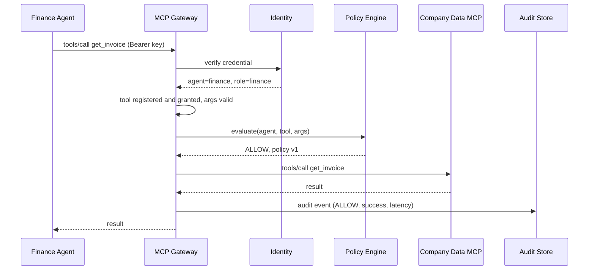
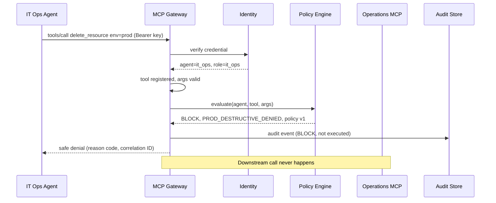
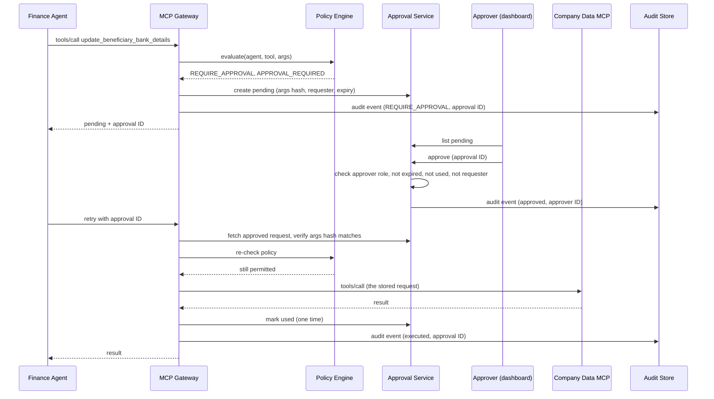

# Architecture — Identity, Gateway Trust Boundary and Request Flows (v2)

> Status: **v2, reviewed.** Review answers are in section 8.
> Companions: `docs/permission-matrix.md` (rules and reason codes), `docs/threat-model.md` (threats, logging and redaction).
> The diagrams are logical. The implementation must use the official Python MCP SDK and preserve MCP `tools/list` and `tools/call` semantics.

---

## 1. Components

| Component | Role | Trusted? |
| --------- | ---- | -------- |
| Business agents (Finance, IT Ops, Developer) | Plain Python tool-calling loops using Gemini | **No** |
| MCP Gateway | MCP server facing agents, MCP client facing downstream servers | Yes |
| Identity module | Verifies credentials, resolves agent ID and role | Yes |
| Policy engine | Deterministic YAML rules, returns decision, reason code, policy version | Yes |
| Approval service | Stores pending requests, accepts approver decisions | Yes |
| Audit store | PostgreSQL, hash-chained events | Yes |
| Downstream MCP servers | Company Data, Operations, Developer Tools (mock) | Trusted only via the gateway |
| Admin API and dashboard | FastAPI plus React for approvals and audit views | Yes (approver login) |

---

## 2. Trusted identity mechanism

**Proposal (v1):** per-agent API key sent as a bearer token on every MCP HTTP request.

1. **Registration:** an admin registers an agent (ID, role, status). The system generates a long random key and shows it once.
2. **Storage:** the registry stores only a hash of the key (never the key), plus role, status, expiry and a key version.
3. **Presentation:** the agent's MCP client sends `Authorization: Bearer <key>` on every request.
4. **Verification:** the gateway hashes the presented key, looks it up, and checks status and expiry. It then sets the agent ID and role in the server-side request context.
5. **Use:** every later step (tool list filtering, policy, audit) reads identity from that context. Any `agent_name` or similar field in a payload is ignored, and logged as a spoofing attempt if it conflicts.
6. **Rotation and revocation:** keys have an expiry. A new key version replaces the old one. Disabling an agent takes effect on the next request.
7. **Failure:** a missing, unknown, expired or disabled credential returns a safe denial (`UNREGISTERED_AGENT`, P-002) and is audited.

**Optional hardening (later):** exchange the API key for a short-lived signed JWT, so the key is not sent on every call. Not needed for the MVP.

Approver login for the dashboard is separate: a username and password (or token) for the one `approver` role, never usable as an agent credential.

---

## 3. Gateway request pipeline

Every `tools/call` goes through the same ordered steps. A failure at any step ends the request with BLOCK.

1. Generate a correlation ID.
2. Authenticate the credential and set identity from it (P-002).
3. Check the tool name is in the approved registry (P-001).
4. Check the tool is granted to this agent's role (P-003).
5. Validate arguments against the tool's JSON schema (P-004).
6. Ask the policy engine: decision, reason code, policy version.
7. Act on the decision: forward, deny, or create an approval.
8. Write the audit event, including the hash-chain link.
9. Return a result or a safe denial to the agent. No stack traces, no policy internals beyond the reason code.

`tools/list` follows the same authentication, then returns only the tools granted to that agent (plus the Scenario C demo override).

If the policy engine or the audit store is unavailable, the call is denied (P-013). Nothing is forwarded without a decision and a way to record it.

---

## 4. Flow: ALLOW

Example: Finance Agent calls `get_invoice`.

---

## 5. Flow: BLOCK

Example: IT Ops Agent calls `delete_resource` with `env=prod` (Scenario B). The downstream server is never contacted.

---

## 6. Flow: REQUIRE_APPROVAL

Example: Finance Agent calls `update_beneficiary_bank_details` (Scenario A). Per the decision made earlier, the agent receives "pending" immediately and polls or retries.

Rejection, expiry, a changed-arguments retry, a replayed approval, or a policy change that now forbids the call all end in a safe denial and an audit event. The retry never runs different arguments than the ones that were approved.

Approvals expire after 15 minutes by default (configurable). The polling and retry loop lives in a small helper in each agent's MCP client wrapper, so the agents do not re-implement it.

---

## 7. Network boundary (Docker Compose)

| Network | Members | Purpose |
| ------- | ------- | ------- |
| `agent_net` | business agents, gateway | The only network agents can see |
| `internal_net` | gateway, downstream MCP servers, PostgreSQL, API | No route from agents; downstream ports are not published to the host |

- Only the gateway is on both networks.
- A test runs from inside an agent container and proves every downstream server is unreachable.
- The unprotected baseline environment is a separate Compose profile, clearly labelled, where agents do reach the servers directly.

---

## 8. Review decisions

1. Identity: per-agent API key as a bearer token, hashed in the registry and shown once; JWT exchange is a later option.
2. Approval polling and retry: a helper in each agent's MCP client wrapper.
3. Approval expiry: 15 minutes by default, configurable.

---

## 9. Stage 2 as built

| Part | Where | What it does |
| ---- | ----- | ------------ |
| Agent registry | `gateway/identity/registry.py` | Agent ID, role, status, credential hash and expiry; issue, rotate, disable, authenticate |
| Identity middleware | `gateway/identity/middleware.py` | Verifies the bearer key on every HTTP request and puts the result in the request scope |
| Tool registry | `gateway/mcp_gateway/tool_registry.yaml`, `tools.py` | 22 approved tools, each with a downstream server, owner, sensitivity and granted roles |
| Gateway | `gateway/mcp_gateway/server.py` | MCP server for agents, MCP client for downstream servers |
| Policy hook | `gateway/policy/decision.py` | `PolicyEngine` interface and reason codes. `AllowAllPolicy` is a test double only; the running gateway uses the Stage 3 `RuleEngine` |
| Policy engine | `gateway/policy/engine.py`, `policy_file.py`, `rate_limit.py`, `policies/policy.yaml` | YAML rules (first match wins, per-tool default), per-agent token-bucket rate limit, policy version = `policy_version` + first 8 hex of the file's SHA-256. Start-up fails if the policy and the tool registry disagree |
| Audit | `gateway/mcp_gateway/audit.py` | One event per call; no raw keys and no argument values (arguments are hashed) |
| Docker | `Dockerfile`, `infra/docker-compose.yml` | `agent_net` / `internal_net` boundary and the labelled `baseline` profile |

**`tools/call` order inside the gateway:** correlation ID, identity, tool in registry, role granted, identity-like arguments stripped and logged as a spoof attempt, strict schema validation, policy, forward with timeout, audit. Every step fails closed, and a denial never reaches a downstream server.

**Choices worth knowing**

- Identity comes only from the verified key. A payload field such as `agent_name` is never trusted; it is removed and recorded.
- `tools/list` is filtered by role, so an agent cannot even see tools it has no grant for. `get_employee_record`, `read_payroll` and `read_env_secrets` have no role grants.
- Downstream tool schemas do not forbid extra properties, so the gateway closes them itself and rejects unknown arguments.
- Denials return a decision, reason code, correlation ID and a short message. No stack traces or internal details.
- The gateway does not start if the registry file is invalid, the database is unreachable, or an approved tool is missing from its downstream server.

**Network proof (AC-11):** `tests/integration/test_network_isolation.py` starts the real Compose stack under its own project name and checks from inside the agent container that the gateway is reachable, and that each MCP server and PostgreSQL are not, by name and by IP address. It also checks no downstream port is published to the host, and that the `agent-baseline` container (the deliberately unprotected profile) can reach a server directly. The test is skipped when no Docker daemon is available.