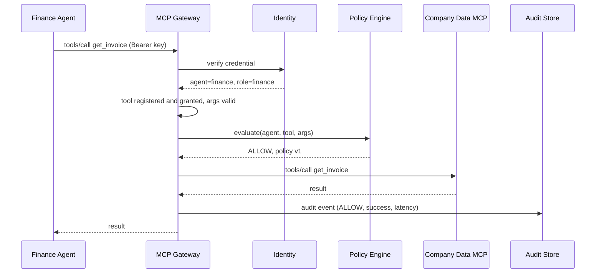
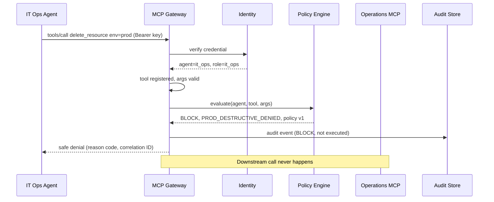
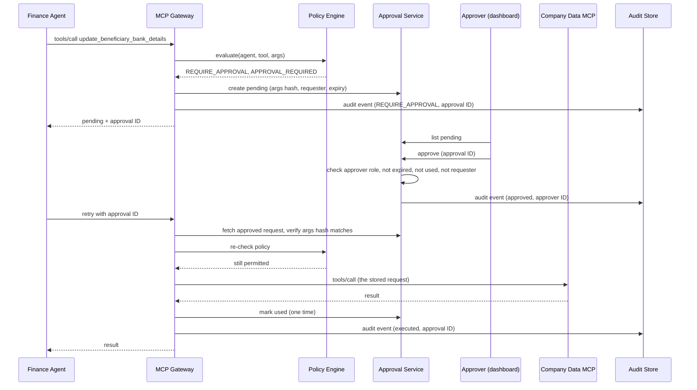

# Architecture — Identity, Gateway Trust Boundary and Request Flows (v2)

> Status: **v2, reviewed.** Review answers are in section 8.
> Companions: `docs/permission-matrix.md` (rules and reason codes), `docs/threat-model.md` (threats, logging and redaction).
> The diagrams are logical. The implementation must use the official Python MCP SDK and preserve MCP `tools/list` and `tools/call` semantics.

---

## 1. Components

| Component | Role | Trusted? |
| --------- | ---- | -------- |
| Business agents (Finance, IT Ops, Developer) | Plain Python tool-calling loops using Gemini | **No** |
| MCP Gateway | MCP server facing agents, MCP client facing downstream servers | Yes |
| Identity module | Verifies credentials, resolves agent ID and role | Yes |
| Policy engine | Deterministic YAML rules, returns decision, reason code, policy version | Yes |
| Approval service | Stores pending requests, accepts approver decisions | Yes |
| Audit store | PostgreSQL, hash-chained events | Yes |
| Downstream MCP servers | Company Data, Operations, Developer Tools (mock) | Trusted only via the gateway |
| Admin API and dashboard | FastAPI plus React for approvals and audit views | Yes (approver login) |

---

## 2. Trusted identity mechanism

**Proposal (v1):** per-agent API key sent as a bearer token on every MCP HTTP request.

1. **Registration:** an admin registers an agent (ID, role, status). The system generates a long random key and shows it once.
2. **Storage:** the registry stores only a hash of the key (never the key), plus role, status, expiry and a key version.
3. **Presentation:** the agent's MCP client sends `Authorization: Bearer <key>` on every request.
4. **Verification:** the gateway hashes the presented key, looks it up, and checks status and expiry. It then sets the agent ID and role in the server-side request context.
5. **Use:** every later step (tool list filtering, policy, audit) reads identity from that context. Any `agent_name` or similar field in a payload is ignored, and logged as a spoofing attempt if it conflicts.
6. **Rotation and revocation:** keys have an expiry. A new key version replaces the old one. Disabling an agent takes effect on the next request.
7. **Failure:** a missing, unknown, expired or disabled credential returns a safe denial (`UNREGISTERED_AGENT`, P-002) and is audited.

**Optional hardening (later):** exchange the API key for a short-lived signed JWT, so the key is not sent on every call. Not needed for the MVP.

Approver login for the dashboard is separate: a username and password (or token) for the one `approver` role, never usable as an agent credential.

---

## 3. Gateway request pipeline

Every `tools/call` goes through the same ordered steps. A failure at any step ends the request with BLOCK.

1. Generate a correlation ID.
2. Authenticate the credential and set identity from it (P-002).
3. Check the tool name is in the approved registry (P-001).
4. Check the tool is granted to this agent's role (P-003).
5. Validate arguments against the tool's JSON schema (P-004).
6. Ask the policy engine: decision, reason code, policy version.
7. Act on the decision: forward, deny, or create an approval.
8. Write the audit event, including the hash-chain link.
9. Return a result or a safe denial to the agent. No stack traces, no policy internals beyond the reason code.

`tools/list` follows the same authentication, then returns only the tools granted to that agent (plus the Scenario C demo override).

If the policy engine or the audit store is unavailable, the call is denied (P-013). Nothing is forwarded without a decision and a way to record it.

---

## 4. Flow: ALLOW

Example: Finance Agent calls `get_invoice`.

---

## 5. Flow: BLOCK

Example: IT Ops Agent calls `delete_resource` with `env=prod` (Scenario B). The downstream server is never contacted.

---

## 6. Flow: REQUIRE_APPROVAL

Example: Finance Agent calls `update_beneficiary_bank_details` (Scenario A). Per the decision made earlier, the agent receives "pending" immediately and polls or retries.

Rejection, expiry, a changed-arguments retry, a replayed approval, or a policy change that now forbids the call all end in a safe denial and an audit event. The retry never runs different arguments than the ones that were approved.

Approvals expire after 15 minutes by default (configurable). The polling and retry loop lives in a small helper in each agent's MCP client wrapper, so the agents do not re-implement it.

---

## 7. Network boundary (Docker Compose)

| Network | Members | Purpose |
| ------- | ------- | ------- |
| `agent_net` | business agents, gateway | The only network agents can see |
| `internal_net` | gateway, downstream MCP servers, PostgreSQL, approver API | No route from agents; downstream and approver API ports are not published to the host |

- Only the gateway is on both networks.
- A test runs from inside an agent container and proves every downstream server is unreachable.
- The unprotected baseline environment is a separate Compose profile, clearly labelled, where agents do reach the servers directly.

---

## 8. Review decisions

1. Identity: per-agent API key as a bearer token, hashed in the registry and shown once; JWT exchange is a later option.
2. Approval polling and retry: a helper in each agent's MCP client wrapper.
3. Approval expiry: 15 minutes by default, configurable.

---

## 9. Stage 2 as built

| Part | Where | What it does |
| ---- | ----- | ------------ |
| Agent registry | `gateway/identity/registry.py` | Agent ID, role, status, credential hash and expiry; issue, rotate, disable, authenticate |
| Identity middleware | `gateway/identity/middleware.py` | Verifies the bearer key on every HTTP request and puts the result in the request scope |
| Tool registry | `gateway/mcp_gateway/tool_registry.yaml`, `tools.py` | 22 approved tools, each with a downstream server, owner, sensitivity and granted roles |
| Gateway | `gateway/mcp_gateway/server.py` | MCP server for agents, MCP client for downstream servers |
| Policy hook | `gateway/policy/decision.py` | `PolicyEngine` interface and reason codes. `AllowAllPolicy` is a test double only; the running gateway uses the Stage 3 `RuleEngine` |
| Policy engine | `gateway/policy/engine.py`, `policy_file.py`, `rate_limit.py`, `policies/policy.yaml` | YAML rules (first match wins, per-tool default), per-agent token-bucket rate limit, policy version = `policy_version` + first 8 hex of the file's SHA-256. Start-up fails if the policy and the tool registry disagree |
| Audit | `gateway/mcp_gateway/audit.py` | One event per call; no raw keys and no argument values (arguments are hashed) |
| Docker | `Dockerfile`, `infra/docker-compose.yml` | `agent_net` / `internal_net` boundary and the labelled `baseline` profile |

**`tools/call` order inside the gateway:** correlation ID, identity, tool in registry, role granted, identity-like arguments stripped and logged as a spoof attempt, strict schema validation, policy, forward with timeout, audit. Every step fails closed, and a denial never reaches a downstream server.

**Choices worth knowing**

- Identity comes only from the verified key. A payload field such as `agent_name` is never trusted; it is removed and recorded.
- `tools/list` is filtered by role, so an agent cannot even see tools it has no grant for. `get_employee_record`, `read_payroll` and `read_env_secrets` have no role grants.
- Downstream tool schemas do not forbid extra properties, so the gateway closes them itself and rejects unknown arguments.
- Denials return a decision, reason code, correlation ID and a short message. No stack traces or internal details.
- The gateway does not start if the registry file is invalid, the database is unreachable, or an approved tool is missing from its downstream server.

**Network proof (AC-11):** `tests/integration/test_network_isolation.py` starts the real Compose stack under its own project name and checks from inside the agent container that the gateway is reachable, and that each MCP server and PostgreSQL are not, by name and by IP address. It also checks no downstream port is published to the host, and that the `agent-baseline` container (the deliberately unprotected profile) can reach a server directly. The test is skipped when no Docker daemon is available.

---

## 10. Stage 4 as built (human-in-the-loop approval)

| Part | Where | What it does |
| ---- | ----- | ------------ |
| Approval store | `gateway/approvals/store.py` | The `approvals` table: exact request (tool, arguments, requester), argument hash, policy reason and version, status, expiry, approver, execution result. `create`, `decide`, `consume`, `list_pending` |
| Gateway | `gateway/mcp_gateway/server.py` | On `REQUIRE_APPROVAL`: stores the request, returns "pending" with `approval_id` and `expires_at`. On a retry with the ID in `_meta.approval_id`: evaluates policy again, then spends the approval |
| Approver API | `apps/api/main.py`, `python -m apps.api` | FastAPI: `GET /approvals/pending`, `GET /approvals/{id}`, `POST /approvals/{id}/approve`, `POST /approvals/{id}/reject`. HTTP Basic login from `APPROVER_USERNAME` / `APPROVER_PASSWORD` |
| Agent helper | `agents/business/gateway_client.py` | `call_tool_with_approval`: calls, and if the gateway says "pending" retries with the approval ID until a final answer or the wait runs out. `run_agent` uses it, with `approval_wait_seconds` (default 0: do not wait) |

**Rules, and where each is enforced**

- **Bound to the exact request:** a retry must be the same agent, the same tool and the same argument hash (`APPROVAL_MISMATCH` otherwise). What runs is the stored arguments, not the retry's.
- **Policy re-checked:** the retry goes through the full pipeline first. If the rules now say BLOCK, the call is blocked and the approval stays unspent. If they no longer ask for approval, the call is evaluated on its own merits.
- **One use:** `consume` is one conditional `UPDATE ... WHERE status = 'approved'`, so two concurrent retries cannot both succeed (`APPROVAL_ALREADY_USED`).
- **Expiry:** `expires_at = created + APPROVAL_EXPIRY_MINUTES` (default 15). Status "expired" is derived from the clock, so an old row is dead even if nothing touched it.
- **Who decides:** only the approver login. Agent API keys are rejected by the approver API, and the gateway exposes no approval tool. The store also refuses a decision when the approver ID equals the requesting agent's ID.
- **No double decision:** an approved request cannot be rejected afterwards or the reverse (`409`).
- **Audit:** the pause, the human decision (`approval/decide`, with `approver_id`, time and the requester) and the execution result are separate audit events sharing `approval_id`. Argument values never go in the audit log.
- **Safe errors:** agents see `APPROVAL_PENDING`, `APPROVAL_REJECTED`, `APPROVAL_EXPIRED`, `APPROVAL_ALREADY_USED`, `APPROVAL_MISMATCH` or `APPROVAL_INVALID` (unknown, malformed or someone else's ID: deliberately not told apart).

**Choices worth knowing**

- The same agent asking again for the same pending request gets the same `approval_id`, so an agent that loops cannot flood the approver.
- The approval ID travels in the MCP `_meta` field, not in the tool arguments, so tool schemas and the strict argument check are unchanged and a standard MCP client still works.
- With no `ApprovalStore` given, the gateway behaves exactly as in Stage 3 (`REQUIRE_APPROVAL` is a plain denial).
- **Docker:** `approver-api` is a Compose service on `internal_net` only, sharing the gateway's database. It publishes **no port** by default. A live probe showed that a published port is reachable from other Docker networks by container IP (PostgreSQL's dev port is too), which would give agents a network route to the approve endpoint. A test now proves the agent cannot reach it by name or IP. To approve from the host, opt in with `-f infra/docker-compose.approver-host.yml`, which publishes it on `127.0.0.1` and says what that costs.
- **Outside Docker:** `uv run python -m apps.api` against the gateway's database. The React dashboard (Stage 7) will call it.
- **Live run:** the real gateway, approver API and three MCP servers as separate processes over HTTP, first on SQLite and then on PostgreSQL 16 in Docker. Both runs behaved as in the tests: login required (an agent key gets 401), pending, mismatch, approve, run once with the downstream result, replay refused, rejection refused. The PostgreSQL rows show one `used` / `approver` / `ok` and one `rejected`. The audit lines and the check that no argument value appears in any log line were read on the SQLite run only.

---

## 11. Stage 5 as built (audit trail and behaviour monitoring)

| Part | Where | What it does |
| ---- | ----- | ------------ |
| Redaction | `monitoring/audit/redact.py` | `sanitize_args`: secret-named fields become `[redacted]`, account numbers keep the last 4 digits, key-like strings and long digit runs are masked, long free text becomes `[text:N chars]`. IDs, limits and amounts survive because detections need them. Idempotent, so the store applies it again |
| Audit store | `monitoring/audit/store.py` | `audit_events` + one-row `audit_head`. Each record holds `prev_hash` and `record_hash` = SHA-256(prev hash, sequence number, canonical JSON). `verify()` walks the chain |
| Audit event | `gateway/mcp_gateway/audit.py` | New fields `sanitized_args`, `enforcement_action`, `anomaly_score`. `decision` (policy), `enforcement_action` (what the gateway did) and `anomaly_score` (what the monitor thought) are separate columns and separate JSON fields |
| Rule monitor | `monitoring/detection/rules.py` | `BehaviourMonitor`: BURST, LARGE_EXPORT, REPEATED_DENIALS, UNUSUAL_SEQUENCE, OFF_HOURS. Per-agent sliding windows over event timestamps; no randomness, no wall clock |
| Alerts and sink | `monitoring/detection/alerts.py` | `MonitoredAuditSink`: score, then store in the chain, then save alerts. `alerts` table; each alert lists the correlation IDs of the audit events behind it |
| Simulator | `monitoring/detection/simulator.py` | Seeded labelled traffic: normal sessions plus six attack kinds |
| Anomaly model | `monitoring/detection/anomaly.py` | Isolation Forest on 5-minute per-agent windows, trained on normal traffic only. Optional |
| Evaluation | `monitoring/detection/evaluate.py` | Trains on one seed, tests on another, reports per-kind catches, false alarms, precision and recall |
| Command line | `python -m monitoring verify / alerts / evaluate` | `verify` exits 1 if the chain is broken |

**Rules, and where each is enforced**

- **Every call is recorded, denied ones too.** The gateway writes one event per request (`tools/list`, `tools/call`, `approval/decide`) at every exit of the pipeline. The approver API writes into the same chain.
- **No audit, no call (P-013).** Before the policy runs, the gateway calls `audit.check()`. If the store is unusable the call is denied with `POLICY_UNAVAILABLE` and nothing is forwarded. If the store fails between the check and the write, the failure is logged loudly and the agent still gets its answer: the decision was already made and a call that ran must not look as if it did not.
- **Tamper evidence.** Editing a record breaks its hash; changing a record and recomputing its hash breaks the next link; deleting or inserting breaks the sequence; cutting records off the end is caught by the head row; the indexed columns are compared with the hashed JSON. Writes lock the head row (`SELECT ... FOR UPDATE`), so the gateway and the approver API, separate processes, extend one chain.
- **What the chain does not do.** Someone with full write access to the database could rewrite every record and the head consistently. The chain makes silent change *detectable by whoever runs `verify`*; to resist that attacker, copy `head()` to somewhere the database user cannot write (not done).
- **Monitoring never decides.** The monitor reads events after the policy decision. `policy`, `identity` and `approvals` do not import it, and a test fails if they do. A test also runs the same calls with a monitor that scores everything 1.0 and shows identical decisions and identical downstream calls. What a risk level does is fixed in `RESPONSE_BY_LEVEL`: alert, nothing more.
- **Monitoring is best-effort.** If the monitor or the alert store fails, the audit record is still written.

**Choices worth knowing**

- Tool *results* are never stored (a test reads `read_env_secrets` through the gateway and finds none of its fake values in the log). Identity claims in a payload are stored as field names only (`spoofed_fields`), not as values.
- The LARGE_EXPORT ceilings (export 500, list 200) sit well above the policy limits (100, 50) on purpose. The policy already stops a call just over its limit; the alert is for asking for several times more. The first, tighter setting raised 3 false alarms on normal traffic, which is how this was found.
- The model first caught only 8 of 36 attack episodes. Training on 5 simulated days (125 windows) was too little; 20 days (about 500) and a 2% false-alarm setting gave the results below. **Tuning caveat:** the first sweep over training length and false-alarm rate was run on the test seed (2002), and the LARGE_EXPORT ceilings were changed after seeing false alarms on that same seed. A second sweep on a separate seed (3003) pointed the same way, but the reported numbers are still tuned on their own test data and are optimistic. A fair figure needs a fresh seed that was never looked at.

**Measured results** (simulated traffic written by this project; `uv run python -m monitoring evaluate`; train seed 1001 on normal only, test seed 2002: 120 normal sessions, 36 attacks, 6 of each kind)

| Attack kind | Rules | Model |
| ----------- | ----- | ----- |
| burst | 6/6 | 0/6 |
| large_export | 6/6 | 6/6 |
| repeated_denials | 6/6 | 6/6 |
| unusual_sequence | 6/6 | 4/6 |
| off_hours | 6/6 | 0/6 |
| slow_scrape | 0/6 | 0/6 |

False alarms on 120 normal sessions: rules 0, model 4. Window level (5 minutes per agent): rules precision 1.00, recall 0.74; model precision 0.84, recall 0.37; combined precision 0.91, recall 0.74.

What this shows, and does not: the rules catch every attack they were written for with no false alarms, and miss the slow scrape by design. The model adds nothing on top of the rules on this data (combined recall equals rules recall) and costs 4 false alarms, so it stays optional and alert-only. The slow scrape (about 12 reads a minute, under every threshold) is missed by both; that is an honest gap, not a result to hide. These numbers come from synthetic traffic with the same author as the detectors, so they show the pipeline works, not how it would do on real traffic.

**Live checks**

- On PostgreSQL 16 (Docker): 4 threads over 2 `AuditStore` objects wrote 100 records into one unforked chain that verified; an `UPDATE` of record 42 was then reported at record 42.
