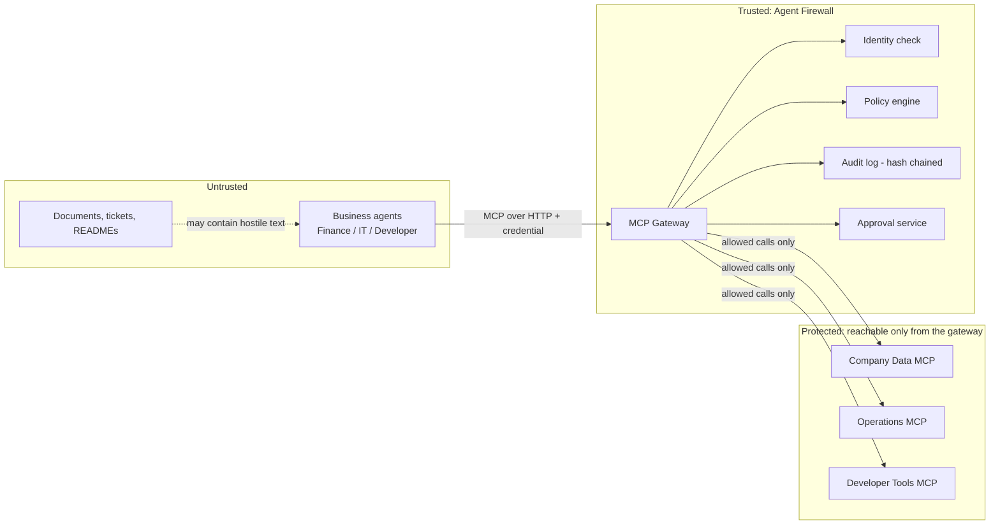

# Threat Model — v2 (review answers applied)

> Status: **v2, reviewed.** Review answers are in section 8.
> Scope: the Agent Firewall MVP (synthetic data, mock operations, local Docker Compose).
> Companion: `docs/permission-matrix.md` (rules P-001 to P-013 referenced below).

---

## 1. What we protect (assets)

| ID  | Asset | Why it matters |
| --- | ----- | -------------- |
| A1  | Beneficiary bank details and payments | Fraud target (Scenario A) |
| A2  | Sensitive records: customers, employees, payroll | Data exposure and bulk export (Scenario D) |
| A3  | Secrets and environment variables | Credential theft (Scenario C) |
| A4  | Production resources and monitoring | Destructive actions (Scenario B) |
| A5  | Protected repository branches | Unreviewed code reaching `main` |
| A6  | Agent credentials (API keys / JWTs) | Impersonation |
| A7  | Policy files and tool registry | Tampering would silently weaken every rule |
| A8  | Audit log | Evidence; must be trustworthy |
| A9  | Approval records | Must stay bound to the exact request |

All data in the MVP is synthetic and all operations are mocks. The model describes how the design would protect real equivalents.

---

## 2. Who or what may attack (threat actors)

| ID  | Actor | Capability |
| --- | ----- | ---------- |
| T1  | Prompt-injected business agent | Legitimate credential, but its tool choices are controlled by hostile text (invoice, ticket, README) |
| T2  | Malicious content author | Plants instructions in documents the agents read |
| T3  | Compromised or buggy agent | Sends malformed, oversized or unusual requests; may lie about its identity |
| T4  | Credential thief | Holds a stolen API key or JWT |
| T5  | Gateway bypasser | Tries to reach downstream MCP servers directly |
| T6  | Insider or tamperer | Edits policy files, the registry or audit records |
| T7  | Approval abuser | Tries to alter, replay, expire-extend or self-approve an approval |
| T8  | Poisoned tool metadata | A downstream tool description changes to manipulate the agent (tool poisoning / rug-pull) |

---

## 3. Trust boundaries

Rules at each boundary:
- **Agent to gateway:** everything the agent sends is untrusted input. Identity comes only from the verified credential, never from a payload field.
- **Gateway to downstream:** only calls the policy engine allowed. Downstream servers are on an internal Docker network the agents cannot reach.
- **LLMs:** the business agents' LLM output is untrusted. The investigation LLM output is advisory and cannot change policy.

---

## 4. Threats and mitigations

| Threat | Actor | Attack | Mitigation | Planned stage |
| ------ | ----- | ------ | ---------- | ------------- |
| Spoofed identity | T3, T4 | Agent writes another `agent_name`; or uses a stolen key | Identity from verified credential only; spoofed fields ignored (P-002); key expiry and rotation; disabled agents rejected | 2 |
| Unknown tool | T1, T3 | Calls a tool not in the registry | Deny by default (P-001) | 2, 3 |
| Cross-agent access | T1, T3 | Calls a tool granted to another role | Tool not granted (P-003); `tools/list` filtered per agent | 2, 3 |
| Bank-detail change via injected text | T1, T2 | Invoice tells agent to change beneficiary | Tool is REQUIRE_APPROVAL (P-011); executes only after valid approval | 3, 4 |
| Secrets read | T1, T2 | README tells agent to read env vars | `read_env_secrets` always BLOCK (P-010) | 3 |
| Destructive production action | T1, T3 | Delete resource or disable monitoring in prod | BLOCK (P-007) before reaching the server | 3 |
| Protected branch abuse | T1 | Push or delete `main` | BLOCK (P-008) | 3 |
| Restricted service restart | T1 | Restart `auth` or `monitoring` in prod | BLOCK (P-009) | 3 |
| Sensitive bulk export | T1, T3 | Export customers, employees, payroll or huge invoice sets | Table allow-list (P-006), limits (P-005), approval above threshold (P-011) | 3, 4 |
| Malformed or oversized arguments | T3 | Injection-style or invalid values | Schema validation (P-004) | 2, 3 |
| Request flooding | T3 | Burst of calls | Rate limit (P-012) plus burst detection rule | 3, 5 |
| Gateway bypass | T5 | Agent calls downstream servers directly | Internal Docker network; downstream ports not published; agents have only the gateway address; an automated test proves an agent container cannot reach any downstream server | 2, 8 |
| Policy or registry tampering | T6 | Edits YAML or registry | Policy version recorded on every decision; files in version control; read-only mount in containers | 3, 8 |
| Audit tampering | T6 | Edits or deletes past records | Hash-chained log with a verification check | 5 |
| Approval tampering | T7 | Change arguments after approval | Approval bound to a hash of the exact request; mismatch rejected | 4 |
| Approval replay or expiry | T7 | Reuse an approval or use it late | One-time use; expiry enforced; duplicates rejected | 4 |
| Self-approval | T7 | Requesting agent approves its own request | Only the approver role may approve; requester cannot | 4 |
| Tool poisoning / rug-pull | T8 | Downstream tool description changes | Optional extra: pin tool descriptions and alert on change | optional |
| Policy engine down | any | Outage causes unchecked calls | Fail closed (P-013) | 3 |
| Prompt injection itself | T2 | Hostile text steers the agent | **Not prevented.** Only the resulting forbidden call is stopped | n/a |
| Allowed-but-abusive behaviour | T1, T3 | Permitted calls used at unusual volume or order | Rule-based detections, then optional ML; alert, approval or block per explicit policy | 5 |
| Secrets leaking into logs | any | Arguments or results contain credentials | Redaction before storage (section 5) | 5 |
| LLM overreach | T1 | Investigator changes policy or runs remediation | Investigation agents are advisory only; no write access to policy or tools | 6 |

---

## 5. Logging and redaction rules

**Stored in every audit event**
- timestamp, correlation ID
- authenticated agent identity and role
- tool name, target server, resource
- sanitized arguments
- policy version, decision, reason code
- approval reference (if any)
- execution status, latency
- previous-record hash and this record's hash (hash chain)

**Never stored**
- raw API keys, JWTs or passwords
- secret values returned by any tool (including mock secrets)
- full bank account numbers (store only the last 4 digits and an argument hash)
- full personal data fields (store IDs, not names or addresses)

**Sanitizing approach**
- Redact by field name (`password`, `token`, `secret`, `account_number`, `key`) and by pattern (long digit strings, key-like strings)
- Store a hash of the full original arguments, so an approval can be bound to them without keeping the raw values in the log
- Tool results are summarized (status, record count), not stored in full

**Error handling**
- Agents receive a safe denial: decision, reason code, correlation ID. No stack traces, no policy internals beyond the reason code.

---

## 6. Assumptions

- The gateway host, the policy files and the database are controlled by the operator.
- Agents run in a Docker network with no route to downstream servers.
- Downstream MCP servers are our own mock servers.
- Credentials are issued out of band and kept in `.env` or Docker secrets.
- The system clock is reasonably accurate (needed for expiry).

---

## 7. Out of scope (stated limitations)

- Agents or tools that bypass the gateway are outside the enforcement boundary.
- Detecting or preventing every prompt injection.
- Real production systems, real banking, HR or cloud accounts.
- A compromised gateway host or database administrator.
- Denial-of-service beyond a simple rate limit.
- Enterprise SSO, multi-region availability, Kubernetes.
- Automatic remediation.

---

## 8. Review decisions

1. Approvals are bound to a hash of the exact arguments; the audit log keeps only the last 4 digits of account numbers.
2. Tool-description pinning (T8) stays an optional extra.
3. Add an automated test proving an agent container cannot reach any downstream MCP server (in addition to unpublished ports and an internal Docker network).
